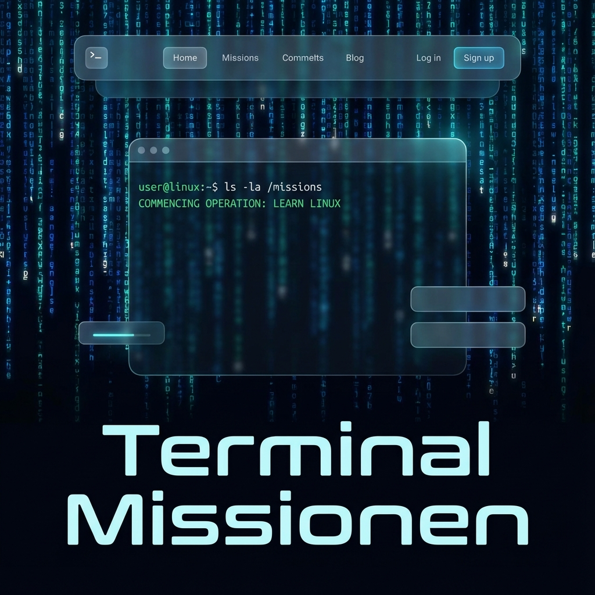
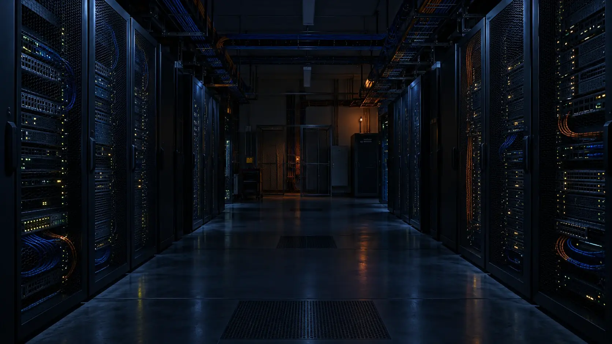
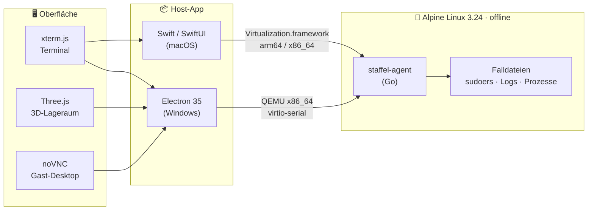

<div align="center">



# NACHTDIFF

**Staffel 2 · Rechenwerk Ostwind**

<a href="https://github.com/arn0ld87/Linux-Krimi-Win-und-Mac/releases/latest">
  
</a>

[](https://github.com/arn0ld87/Linux-Krimi-Win-und-Mac/releases/latest)
[](#-schnellstart)
[](#-schnellstart)
[](#-die-episoden)
[](#-unter-der-haube)
[](#-lizenz)

[▶ Trailer ansehen](Mac/NACHTDIFF.app/Contents/Resources/StaffelZwei-Trailer.mp4) · [⬇ Download](https://github.com/arn0ld87/Linux-Krimi-Win-und-Mac/releases/latest) · [📖 Episoden](#-die-episoden)

</div>

---

## 🌙 Worum geht's?

**NACHTDIFF ist ein Linux-Krimi, den du selbst spielst – in einer echten Linux-VM.**

Nachtschicht im Rechenwerk Ostwind GmbH. Kollege Micha döst im Bürostuhl, die Server blinken vor sich hin – und auf `rw-srv01` läuft etwas, das dort nicht hingehört. Du übernimmst die Fälle: sudo-Regeln, die niemand bestellt hat, Prozesse, die nicht sterben wollen, und eine Lücke im Audit-Log, die viel zu sauber aussieht.

Kein Quiz. Keine Klick-Antworten. Du ermittelst mit **echten Shell-Befehlen** in einem **echten Alpine Linux** – und das Spiel prüft deine Belege Zeile für Zeile.

> *„Die Regel für jeden Fall: erst Belege sichern, dann reparieren. Wer vorher eingreift, verändert den Beweis."*

<div align="center">

</div>

## ✨ Was NACHTDIFF besonders macht

| | Feature | Details |
|---|---|---|
| 🖥️ | **Echte Linux-VM** | Jede Episode bootet ein eigenes Alpine Linux – unter Windows via QEMU, unter macOS via Virtualization.framework. Kein Mock, kein Fake-Terminal. |
| 🔍 | **Beleg-basiertes Ermitteln** | Du sicherst Spuren mit `grep`, `ls`, `cat` & Co. in `~/belege`. Die Engine prüft den **Inhalt** deiner Dateien – nicht nur, ob du sie angelegt hast. |
| 🎧 | **Vertonte Einsätze** | Briefings, Hinweise und Abschlüsse sind gesprochen – mit Transkript. Dazu ein Trailer mit Untertiteln. |
| 🧊 | **3D-Serverraum** | Der Lageraum wird in Three.js gerendert und reagiert auf deinen Ermittlungsstand. |
| 🪜 | **Dreistufige Hinweise** | Jeder Schritt hat drei Hilfen: vom Schubs in die richtige Richtung bis zum fertigen Befehl. Niemand bleibt stecken. |
| 🕵️ | **Verdächtige mit Motiv** | Jede Episode hat einen eigenen Täterkreis. Wer es war, verrät nur dein Beleg – nicht das Menü. |
| 🔌 | **100 % offline** | Kein Netzwerk im Gast (`-net none`), keine Telemetrie, keine Accounts. Läuft komplett lokal. |
| 💾 | **Kampagnen-Spielstand** | Fortschritt wird lokal gespeichert – pro Episode, pro Plattform. |

## 📺 Die Episoden

Sieben Fälle, eine Nachtschicht, ein roter Faden bis zur Übergabe:

| # | Episode | Fallakte | Spuren |
|---|---------|----------|--------|
| 1 | **Zu viele Rechte** | Der Rechtefund | Rechte · Log |
| 2 | **Der Prozess, der nicht stirbt** | Der Wiedergänger | Prozess · Zettel |
| 3 | **Die Lücke im Log** | Die Loglücke | Lücke · Zählung |
| 4 | **Der falsche Anhang** | Freigabe und Vorlage | Freigabe · Vorlage |
| 5 | **Der letzte Export** | Vorschau und Ausgang | Lokaler Ausgang · Sicherung |
| 6 | **Zwei Uhren** | Ortszeit und UTC | Originalzeilen · Zeitfolge |
| 7 | **Die Übergabe** | Staffelfinale | Funktionsprüfung · Fallakte |

<details>
<summary>🎓 <b>Was du dabei ganz nebenbei lernst</b> (aufklappen)</summary>

- **Rechte & sudo** – `/etc/sudoers.d`, Eigentümer, Dateirechte, Änderungskennungen
- **Prozesse** – was ein Wiedergänger ist und wie man ihn sauber beendet
- **Logs** – Audit-Log lesen, Lücken erkennen, Zeilen zählen und belegen
- **Freigaben** – Vorlagen, Anhänge und wer was eingespielt hat
- **Exporte & Sicherung** – Datenabfluss erkennen, Quarantäne statt Löschen
- **Zeit** – Ortszeit vs. UTC, Zeitfolgen rekonstruieren
- **Forensisches Arbeiten** – erst sichern, dann reparieren. Immer.

</details>

## 🎮 So läuft ein Fall

```text
        ┌──────────────┐
        │   Briefing   │  🎧 Alex funkt rein: Was ist auf rw-srv01 passiert?
        └──────┬───────┘
               ▼
        ┌──────────────┐
        │   Sichern    │  🔍 grep -B1 … /etc/sudoers.d/… > ~/belege/rechte-zeile.txt
        └──────┬───────┘
               ▼
        ┌──────────────┐
        │   Belegen    │  📄 Die Engine prüft deine Belege inhaltlich
        └──────┬───────┘
               ▼
        ┌──────────────┐
        │  Überführen  │  🕵️ Kennung abgleichen, Verdächtige prüfen
        └──────┬───────┘
               ▼
        ┌──────────────┐
        │  Quarantäne  │  📦 Auffällige Dateien unverändert wegsperren – nicht löschen
        └──────┬───────┘
               ▼
        ┌──────────────┐
        │  Abschluss   │  🎧 Fall geschlossen – nächste Episode wartet
        └──────────────┘
```

Steckst du fest, hat jeder Schritt **drei Hinweisstufen** – von „schau mal in `/etc/sudoers.d`" bis zum vollständigen Befehl. Und Micha schläft weiter. Meistens.

## 🕵️ Die Belegschaft

<div align="center">

|  |  |  |
|:---:|:---:|:---:|
| **Timo Kessler** | **Nadia Brem** | **Margit Ostwind** |
| Systemadministrator, Fernwartung | Datenbankverwaltung | Schichtleitung und Freigabe |

</div>

Dazu: **Alex** am Funk (deine Einsatzleitung) und **Micha** im Bürostuhl nebenan – Nachtschicht-Kollege, Dauerläufer, gelegentlich wach. Wer in welcher Episode die Finger im Spiel hat, findest du selbst heraus. Spoiler gibt's hier keine.

## 🔧 Unter der Haube



| Schicht | Technik |
|---|---|
| **Windows-App** | Electron 35 · xterm.js · Three.js · noVNC · WebSocket-Brücken |
| **macOS-App** | Swift / SwiftUI · SwiftTerm · Virtualization.framework |
| **Linux-Gast** | Alpine Linux 3.24 (virt) · eigener Go-Agent · gepinnte, SHA-256-geprüfte Pakete |
| **Virtualisierung** | QEMU (Windows, x86_64) · Virtualization.framework (macOS, arm64 + x86_64) |
| **Spiel-Engine** | Missionskatalog als JSON · Belegprüfung mit Pflicht-/Verbotsfragmenten · Hinweisstufen |
| **Medien** | Vertonte Briefings (MP3) · Trailer mit Untertiteln (VTT) · 3D-Szene in Echtzeit |

Der Gast hat **kein Netzwerk** (`-net none`). Alle Falldateien stecken im Initramfs, das reproduzierbar aus gepinnten Alpine-Archiven gebaut wird (`tools/build-linux-guest.py` im Quellprojekt).

## ⚡ Schnellstart

> **Fertig gebaute Pakete gibt's im [Release](https://github.com/arn0ld87/Linux-Krimi-Win-und-Mac/releases/latest)** – Launcher, Linux-Gast und alle Medien sind dort enthalten. Im Repo selbst liegen große Build-Binaries (`.exe`, `initramfs`) bewusst nicht.

### 🍎 macOS (macOS 15+)

1. Passendes Zip aus dem [Release](https://github.com/arn0ld87/Linux-Krimi-Win-und-Mac/releases/latest) laden und entpacken:
   - **Apple Silicon (M1–M4):** `NACHTDIFF-Staffel2-macOS-arm64.zip`
   - **Intel:** `NACHTDIFF-Staffel2-macOS-x64.zip`
2. `NACHTDIFF.app` starten

Die App ist nicht signiert – macOS meckert beim ersten Start. Einmalig im Terminal:

```bash
xattr -dr com.apple.quarantine /pfad/zu/NACHTDIFF.app
```

### 🪟 Windows (10/11, x64)

1. `NACHTDIFF-Staffel2-Windows-x64.zip` aus dem [Release](https://github.com/arn0ld87/Linux-Krimi-Win-und-Mac/releases/latest) laden und **vollständig entpacken**
2. `NACHTDIFF.exe` starten – QEMU und der Linux-Gast sind an Bord

Auch hier gilt: unsigniert. SmartScreen → *Weitere Informationen* → *Trotzdem ausführen*.

## 📁 Repo-Struktur

```text
.
├── Mac/
│   └── NACHTDIFF.app/              # macOS-App (arm64)
│       └── Contents/
│           ├── MacOS/StaffelZwei   # Swift-Binary
│           └── Resources/
│               ├── Missions.json   # 📜 Alle 7 Episoden: Schritte, Belege, Hinweise
│               ├── LinuxGuest/     # 🐧 Alpine-Kernel (arm64)
│               ├── Einsatzszene/   # 🎧 Stimmen, Porträts, Finale-Videos
│               └── StaffelZwei-Trailer.mp4
└── Win/
    └── NACHTDIFF-win64/            # Windows-Distribution (x64)
        └── resources/
            ├── app/                # ⚡ Electron-App (main, engine, guest, renderer)
            ├── qemu/               # 🖥️ QEMU + DLLs
            ├── LinuxGuest/         # 🐧 Alpine-Kernel (x86_64)
            └── Resources/          # 📜 Missionen, Trailer (webm + vtt), Medien
```

Die spannendsten Dateien zum Reinschauen:

- [`Missions.json`](Mac/NACHTDIFF.app/Contents/Resources/Missions.json) – der komplette Episodenkatalog
- [`gameEngine.js`](Win/NACHTDIFF-win64/resources/app/src/gameEngine.js) – Belegprüfung & Spielfluss
- [`linuxGuest.js`](Win/NACHTDIFF-win64/resources/app/src/linuxGuest.js) – QEMU-Start, Agent-Protokoll, VNC-Brücke
- [`room3d.js`](Win/NACHTDIFF-win64/resources/app/src/renderer/room3d.js) – der 3D-Lageraum

## ❓ Kurz-FAQ

**Brauche ich Linux-Vorkenntnisse?**
Nein. Die Hinweisstufen führen dich von null bis zum fertigen Befehl – und du lernst dabei echte Shell-Arbeit, keine Spielzeug-Kommandos.

**Geht etwas kaputt, wenn ich falsch tippe?**
Nein. Jede Episode bootet einen frischen Gast. Deine Belege und dein Spielstand liegen sicher auf dem Host.

**Warum ist die Windows-exe nicht im Repo?**
Große Build-Binaries sind per `.gitignore` ausgeschlossen. Das [Release](https://github.com/arn0ld87/Linux-Krimi-Win-und-Mac/releases/latest) enthält dafür alles fertig zum Starten.

**Laufen die Episoden auf beiden Plattformen gleich?**
Ja – derselbe Missionskatalog, dieselben Belegregeln. Nur die Virtualisierung ist plattformspezifisch (QEMU vs. Virtualization.framework).

## 📜 Lizenz

MIT – siehe [package.json](Win/NACHTDIFF-win64/resources/app/package.json). Alpine Linux, QEMU, Electron und die übrigen Komponenten bringen ihre eigenen Lizenzen mit (siehe `LICENSES.chromium.html` bzw. die jeweiligen Projekte).

---

<div align="center">

**Gebaut von Alexander Schneider** · Nachtschicht läuft. Micha schläft. Noch.

[⬇ Hol dir Staffel 2](https://github.com/arn0ld87/Linux-Krimi-Win-und-Mac/releases/latest)

</div>
